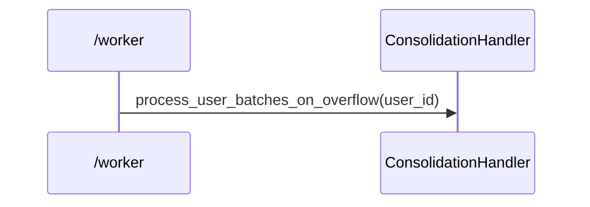

# 06 Runtime View

## 📂 Contents

## 1. A chat turn (Slack / Telegram)


---


```mermaid
sequenceDiagram
    participant P as Slack / Telegram
    participant A as Platform adapter
    participant H as ConversationHandler
    participant C as AgentCoordinator
    participant R as RouterAgent
    
    participant S as SmartResponseAgent
    participant X as Specialists
    
    
    
    participant SS as SessionStore

    P->>A: webhook (/slack/events, /telegram/webhook)
    A->>H: MessageContext

    H->>C: route_message (router_agent)
    C->>R: triage + memory prefetch + active reminders

    C->>S: AgentMessage with enriched_context
    loop DelegationEngine (tool turns)

    C->>X: execute
    X-->>S: result

    
    

    
        
        
        
        
        

        
            
            
            
            
        end

        
            
            
            
            
            
        end

        
            
            
            
            
             + delivery_items
        end

        
        
    
        
        
        
        

        
        
        
        

        
        
        

        
            
            
            
            
        end

        
        
    end

    

    alt Success
        
        

        
            
                
                
            end
        end

        
        H->>SS: append_messages_batch([user, model])
    else Error
        
        
    end
```

1. **Intake.** The adapter verifies the request (Slack signature, Telegram secret token) and enqueues a **named** Cloud Task, so a platform retry is

A busy session waits in-process, then re-queues, then asks the user to resend. When `/worker` hands the event
back, the adapter authorizes the sender against the whitelist (`IAMService.authorize`). Detail: `CLAUDE.md` → Gmail

2. **`ConversationHandler`** (`src/handlers/conversation_handler.py`): `$skill`, `$memory`, `$consolidate` and other `$` commands are handled here before any LLM call; voice notes are
transcribed into the user's own text; other attachments go through `FileConversionService` into GCS
(reference-only parts); `UserAgentFactory.ensure_agents_for_user` builds or refreshes the user's agents.

`SearchEnrichmentService` (ADR-005), the user's active reminders as `agent_notes`; it always routes to Smart.
4. **`SmartResponseAgent`** runs the multi-turn tool loop in `DelegationEngine`

**Responsibilities:**
enqueued as an `agent_execution` Cloud Task and returns an acknowledgement; its result is delivered later by
`AgentWorkerHandler` to the channel that asked. Local tools (skills, workspace, memory-fact drafts, long-turn
jobs) are served by the engine itself. Intents, modes and agents: `src/infrastructure/agent_manifest.py`,
`src/agents/CLAUDE.md`.
5. **Delivery and history.** The handler sends the answer and its delivery items (files, links, rich content) and
writes the user/model pair to the session `{user_id}:{channel_id}`.

**Long turns.** A turn has one 25-minute clock. At 90 s unanswered the user gets a status note and can keep talking;
the finished run posts a late answer with a link. Before the mark a failed Smart turn falls back to Quick

`decisions/long_running_turns.md`.

## 2. Memory formation


`consolidation` Cloud Task is enqueued. On `/worker`, `ConsolidationService` takes the account's memory-write lease and

`docs/05_building_blocks/memory/README.md` §3.


All background work arrives as `POST /worker` (Cloud Tasks or Cloud Scheduler, OIDC-verified) and is dispatched by
  `WorkerHandler` on `task_type`. The task types and their schedules: `docs/07_deployment/SCHEDULERS.md`. Proactive
  messages (reminders, daily email review, job results) go out through `UserNotificationService`.
  
Three more runtime units run outside the main service:


|------|-------------|------|

| Drive indexer | `indexer_main.py` | `drive_sync` ticks for the user drive index (`docs/05_building_blocks/user_drive/README.md`) |


## 4. Failure handling

- **Agents:** `BaseAgent` wraps every execution with a per-agent circuit breaker and timeout (`AgentConfig` in
  `src/infrastructure/agent_config.py`).
  - **Providers:** same-provider retries, then cross-provider failover (`docs/05_building_blocks/provider_resolution/`).
- **The user always gets a displayable message:** a failed primary turn falls back to Quick, and if Quick fails too, to
a synthetic apology (`AgentFallbackService`).

content (`CLAUDE.md` → Debugging Cloud Run).

HTTP endpoints: [API_REFERENCE.md](./API_REFERENCE.md).


  
  


---


```python
{
    
    
    
    
    
    
    
}
```


```python
{
    
    
    
    
    
    "metadata": {"model": "gemini-2.0-flash-thinking", "tokens": 1234}
}
```


```python
message = AgentMessage.create(
    sender="smart_response_agent",
    
    intent=AgentIntent.DELEGATE,
    
)
response = await coordinator.route_message(message)
```


```python
message = AgentMessage.create(
    sender="smart_response_agent",
    recipient="broadcast",
    intent=AgentIntent.QUERY,
    
)

```


```python


```


---


 (last_updated_at + 90 days)


---





latency. See `src/handlers/consolidation_handler.py` for implementation.


**Process:**


**Performance:**


---


  
  
  


---


---


  


---


