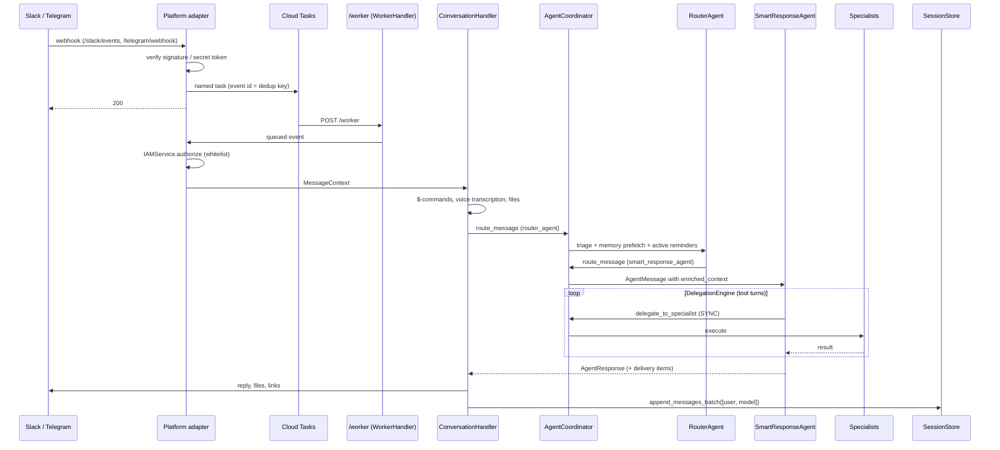

# 06 Runtime View

How work moves through the system at runtime. Each section names the code that owns the step and points to the
document that holds the detail: building-block READMEs, RFCs and decision records under `docs/`.

## 1. A chat turn (Slack / Telegram)

1. **Intake.** The adapter verifies the request (Slack signature, Telegram secret token) and enqueues a **named** Cloud Task, so a platform retry is
   `ALREADY_EXISTS`, not a second turn; every `/worker` delivery is also claimed by task name (`TaskClaimStore`).
   A busy session waits in-process, then re-queues, then asks the user to resend. When `/worker` hands the event
   back, the adapter authorizes the sender against the whitelist (`IAMService.authorize`). Detail: `decisions/worker_task_dedup.md`.
2. **`ConversationHandler`** (`src/handlers/conversation_handler.py`): `$skill`, `$memory`, `$consolidate` and other `$` commands are handled here before any LLM call; voice notes are
   transcribed into the user's own text; other attachments go through `FileConversionService` into GCS
   (reference-only parts); `UserAgentFactory.ensure_agents_for_user` builds or refreshes the user's agents.
3. **`RouterAgent`** (`src/agents/core/router_agent.py`): LLM triage (rule-based fallback), one memory prefetch via
   `SearchEnrichmentService` (ADR-005), the user's active reminders as `agent_notes`; it always routes to Smart.
4. **`SmartResponseAgent`** runs the multi-turn tool loop in `DelegationEngine`
   (`src/infrastructure/delegation_engine.py`). `delegate_to_specialist` goes through
   `AgentCoordinator.handle_delegation`: a **SYNC** intent runs inline and returns its result; an **ASYNC** intent is
   enqueued as an `agent_execution` Cloud Task and returns an acknowledgement; its result is delivered later by
   `AgentWorkerHandler` to the channel that asked. Local tools (skills, workspace, memory-fact drafts, long-turn
   jobs) are served by the engine itself. Intents, modes and agents: `src/infrastructure/agent_manifest.py`,
   `src/agents/CLAUDE.md`.
5. **Delivery and history.** The handler sends the answer and its delivery items (files, links, rich content) and
   writes the user/model pair to the session `{user_id}:{channel_id}`.

**Long turns.** A turn has one 25-minute clock. At 90 s unanswered the user gets a status note and can keep talking;
the finished run posts a late answer with a link. Before the mark a failed Smart turn falls back to Quick
(`AgentFallbackService`); after it, the long-turn machinery owns the outcome. Detail: `decisions/long_running_turns.md`,
`docs/10_rfcs/LONG_RUNNING_TURNS_RFC.md`.

## 2. Memory formation

Sessions are a sliding window: when one exceeds its threshold the oldest batch goes to the consolidation queue and a
`consolidation` Cloud Task is enqueued. On `/worker`, `ConsolidationService` takes the account's memory-write lease and
runs `ConsolidationAgent` on the oldest pending batch. Each step, its thresholds and its failure modes:
`docs/05_building_blocks/memory/README.md` §3.

## 3. Background work

All background work arrives as `POST /worker` (Cloud Tasks or Cloud Scheduler, OIDC-verified) and is dispatched by
`WorkerHandler` on `task_type`. The task types and their schedules: `docs/07_deployment/SCHEDULERS.md`. Proactive
messages (reminders, daily email review, job results) go out through `UserNotificationService`.

Three more runtime units run outside the main service:

| Unit | Entry point | Does |
|------|-------------|------|
| Voice relay | `relay_main.py` | Live call audio between Twilio / Cloudflare SFU and the realtime provider (`docs/10_rfcs/VOICE_COMPANION_RFC.md`) |
| Drive indexer | `indexer_main.py` | `drive_sync` ticks for the user drive index (`docs/05_building_blocks/user_drive/README.md`) |
| Deep research job | `job_main.py` | Claude deep research as a Cloud Run Job (`decisions/cloud_tasks_vs_jobs.md`) |

## 4. Failure handling

- **Agents:** `BaseAgent` wraps every execution with a per-agent circuit breaker and timeout (`AgentConfig` in
  `src/infrastructure/agent_config.py`).
- **Providers:** same-provider retries, then cross-provider failover (`docs/05_building_blocks/provider_resolution/`).
- **The user always gets a displayable message:** a failed primary turn falls back to Quick, and if Quick fails too, to
  a synthetic apology (`AgentFallbackService`).
- **Observability:** Cloud Logging for events, Logfire for the delegation cascade, BigQuery `prompt_content` for LLM
  content (`CLAUDE.md` → Debugging Cloud Run).

HTTP endpoints: [API_REFERENCE.md](./API_REFERENCE.md).
